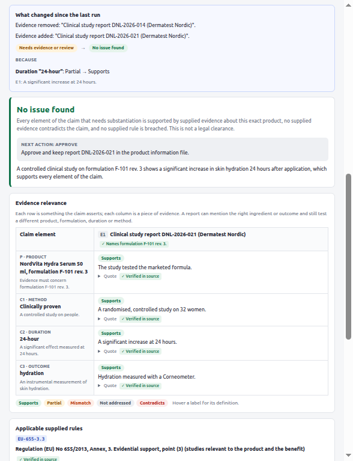
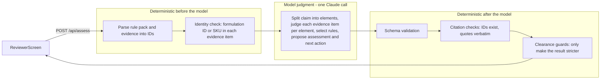
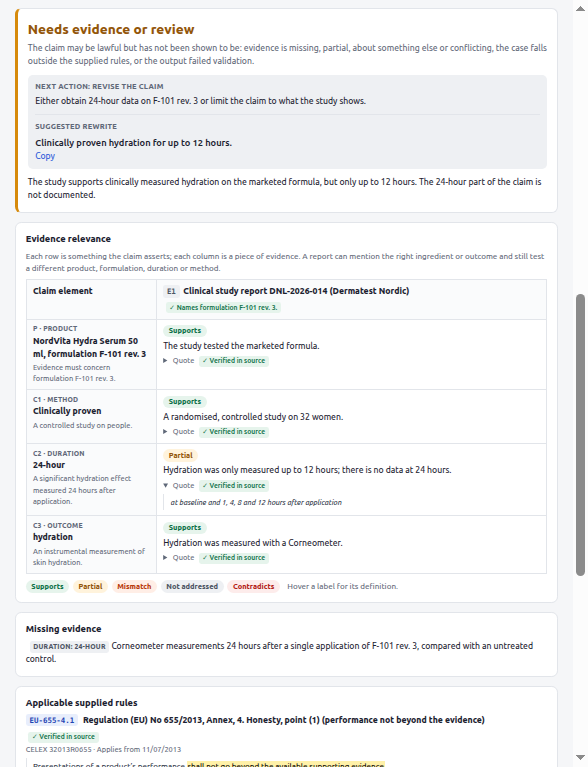
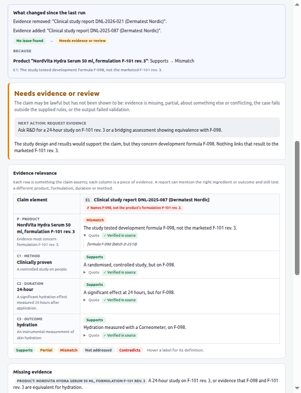

# Claim evidence check

**Does the supplied evidence support this marketing claim under the supplied rules, and what should the reviewer do next?**

A single-screen reviewer tool for performance claims on skin-care cosmetics sold in Denmark. The reviewer pastes a claim, the product context, the legal text to check against and the evidence they have. One model call splits the claim into its parts and judges whether each piece of evidence actually covers each part. Deterministic code then verifies every citation and decides whether a clearance is allowed to stand.



*The screenshots show `npm run demo:scripted`, which sends hand-written model outputs through the real pipeline, so they are not live model results. The deterministic checks, citations and run diff are real.*

## Quick start

Requires Node 22 or later.

```bash
npm install
cp .env.example .env     # add ANTHROPIC_API_KEY; ANTHROPIC_MODEL defaults to claude-sonnet-5-5
npm run dev              # API on :8787, UI on http://localhost:5173
```

| Command | What it does |
| --- | --- |
| `npm run demo:scripted` | The full UI without an API key, with hand-written model outputs for Demo A, B and C |
| `npm test` | 31 unit tests for the deterministic layer and the Anthropic response handling |
| `npm run eval` | The labelled evaluation (the live cases need a key) |
| `npm run eval -- --runs 3` | Repeat each live case to measure how stable the verdicts are |
| `npm run eval -- --print-prompt demo-a-duration-gap` | Print the exact model input for one case |
| `npm run build && npm start` | Production build, served by the API server |

Without a key, the server runs in replay mode. It returns the Claude outputs that `npm run eval` records in `data/recordings.json`, which cover all 12 preset scenarios as long as they are not edited. The repository does not include recordings, so run `npm run eval` once with a key before using replay mode. `npm run demo:scripted` works without either.

## The demo

1. **Demo A.** Claim: "Clinically proven 24-hour hydration." Evidence: a controlled study on the marketed formula F-101 rev. 3, measuring hydration at 1, 4, 8 and 12 hours. Expected result: *Needs evidence or review*. The 24-hour element is marked partial, with the quoted time points, and the suggested rewrite is "Clinically proven hydration for up to 12 hours."
2. **Demo B.** The same design, measured to 24 hours. Expected result: *No issue found*, with the next action to approve and keep the report on file (§ 13). The run diff explains the change: *Duration "24-hour": Partial → Supports*.
3. **Demo C.** The Demo B report, but on development formula F-098. The column header shows the deterministic identity check, *Names F-098, not the product's formulation F-101 rev. 3*. Expected result: *Needs evidence or review*, with a request for a study on F-101 rev. 3 or bridging evidence.
4. In the scripted demo, add `[downgrade]` to the Demo C claim. The scripted "model" now claims *No issue found*, and every quote is genuine; the identity check alone blocks the clearance. Add `[malformed]` to see unusable output handled as "manual review required".

With a live model, the wording of the reasoning will differ. The scripted demo shows the intended result.

## 1. The user problem, and why I chose it

The user is a compliance reviewer who has to approve product copy before launch. Complir's product page shows this workflow: claims such as "clinically proven" are flagged because they need substantiation, and supplier documents are matched to products and verified.

The costly mistake is not missing an obviously illegal claim. It is approving a claim on a document that looks right but doesn't prove it. A report can mention the right ingredient and the right outcome while testing a different formulation, a shorter duration, the raw material in a lab test, or eleven hand-picked customers. For each part of the claim, the reviewer needs to see which document covers it and how. They also need the exact rule text, what is missing, and a concrete next step.

I chose this because it is narrow enough to build and evaluate properly in five hours, and it sits at the centre of Complir's substantiation and document-verification workflows. It also exercises the hard part, judgment under uncertainty with traceable sources, rather than plumbing. Scale (many claims, many markets) and monitoring for law changes are deliberately left as future work.

## 2. Exactly what is covered

**Claims:** performance claims (efficacy, duration, size of effect, consumer perception and cure claims) for leave-on skin-care cosmetics marketed to consumers in Denmark. Each request covers one claim, with evidence as pasted text.

**Rules:** the default rule pack, `data/rules/dk-cosmetic-claims.v1.txt`, has 20 passages quoted from official sources in their original language: Danish law in Danish, EU law in the official English text. It can be edited in the UI. Any pasted legal text works, either with `[RULE-ID] Title | Source | Applicability` headers or as plain paragraphs, which are split into R1, R2, ...

| Rule IDs | Source | Why they are included |
| --- | --- | --- |
| `DK-MFL-5.1`, `5.2.2`, `6.1`, `8.1`, `9`, `13`, `BILAG1-17` | Markedsføringsloven (Marketing Practices Act), LBK nr. 1420/2024; § 5 stk. 2 nr. 2 as amended by lov nr. 558/2025, in force 27 Sep 2026 | Misleading actions and omissions, the material-distortion test, the list of practices that are always prohibited (false cure claims), and the duty to document factual claims |
| `EU-1223-20.1` | Regulation (EC) No 1223/2009, Art. 20(1) | Cosmetics must not imply characteristics they do not have |
| `EU-655-ART2`, `1.2`, `2.2`, `2.3`, `3.1`–`3.7`, `4.1` | Regulation (EU) No 655/2013, common criteria for cosmetic claims | Studies must be "relevant to the product and to the benefit claimed" (3.3); ingredient properties do not transfer to the finished product (2.2, 3.6); weight of evidence (3.7); performance not beyond the evidence (4.1); hyperbole needs no substantiation (3.5) |

The brief links the original 2017 text of the Marketing Practices Act. I used the current consolidation and checked that the provisions in scope are unchanged, except § 5 stk. 2 nr. 2. The 2025 green-transition amendment replaced that from 27 September 2026, and the new wording explicitly mentions "resultaterne af ... afprøvning eller kontrol foretaget af produktet" (the results of tests or checks carried out on the product). Regulation 655/2013 is not in the brief, but it is the binding rule on what counts as substantiation for a cosmetic claim, which is the question this tool answers.

**Situations**, each with an eval case:

- missing evidence
- evidence that stops short of the claimed duration
- evidence on another formulation
- raw-material data offered for a finished-product claim
- conflicting studies
- a study that contradicts the claim
- a claim that overstates the numbers
- a small, self-selected consumer survey
- pure sales language
- sales language with a factual element hidden in it ("bestseller")
- a prohibited cure claim
- three kinds of invalid model output

**Not covered:**

- other product categories and markets
- law outside the pack that several NordVita claims actually turn on: medicines law, food-supplement health claims, price-marking rules, GDPR, the Consumer Ombudsman's guidelines and case law
- images, PDFs and whole web pages
- several claims in one request

## 3. How it works



Each request makes exactly one model call, to the Anthropic Messages API with structured outputs: a JSON schema generated from the Zod schema in `shared/schema.ts`, with enums kept so the API enforces the allowed verdicts. The model's output is a draft; everything after it is code. The prompt (`server/prompt.ts`) is versioned, and each result records the prompt version, model, rule pack hash and latency.

### Where deterministic checks end and model judgment begins

| Deterministic code (`server/`, `shared/`) | Model judgment (one call) |
| --- | --- |
| Parsing the rule pack into citable passages and numbering the evidence E1, E2, ... | Working out what the claim asserts, as the average consumer would read it |
| Product identity check: does each evidence item name the product's formulation ID (or SKU), and which other formulation IDs does it name? | For each claim element and each evidence item: supports, partial, mismatch, not addressed or contradicts |
| Schema validation of the model output | Which elements need substantiation at all (hyperbole doesn't) |
| Every cited rule, evidence and element ID must exist | Which supplied rules apply, and how |
| Every quote must appear word for word in the cited source. Only case, whitespace, quote marks, dashes and ellipses may differ | The proposed assessment, the next action and a suggested rewrite |
| Clearance guards | |

The guards follow one rule: **code can make a result stricter, never more lenient.** The model's *No issue found* stands only if all of these hold:

- the output is valid
- every quote and ID verifies
- every element that needs substantiation has a "supports" entry with a verified quote, from evidence whose identity check passed
- no evidence contradicts the claim
- no missing evidence and no blocking finding is listed
- at least one supplied rule is cited with a verified quote

Otherwise the result becomes *Needs evidence or review*, and the reasons are shown.

Unusable output (malformed, refused or cut off) is never a clearance. An unreachable model produces an error ("nothing was assessed"), never a verdict.

Citation checks establish where a statement came from, not whether a rule was applied correctly: a verbatim quote can still support the wrong conclusion. That is what the evaluation is for.

## 4. Evaluation

`eval/cases.json` has 15 cases. 12 run against the live model, and 3 replace the model with a scripted response to test the deterministic layer. The labels are mine, provisional and not reviewed by a legal expert. I wrote them before any model run, and three live cases are held out from prompt tuning. Each case records the expected assessment, the claim elements that should be flagged, the rules it is acceptable to cite, and a rationale.

Metrics, reported as counts:

- **Expected assessment reached.**
- **False clearances:** the final result is *No issue found* when the label says the case needs review. This is the error that matters most, and the guards exist to keep it at zero.
- **Secondary:** whether the right claim element was flagged (duration in Demo A, product in Demo C) and whether an acceptable rule was cited. This is a partial check that the right reasoning produced the right label.
- **Stability** over repeated runs (`--runs 3`).

Results from `claude-sonnet-5-5`, prompt v2, one run per case (`npm run eval` writes the full table to `eval/results/latest.md`):

| Group | Cases | Expected assessment reached | False clearances |
| --- | --- | --- | --- |
| Live model, development cases | 9 | 9 of 9 | 0 of 7 that should need review |
| Live model, held-out cases | 3 | 2 of 3 | 0 of 3 that should need review |
| Scripted invalid model outputs (deterministic layer) | 3 | 3 of 3 | 0 of 3 that should need review |

Across the live cases:

- the expected claim element was flagged in 10 of 10 cases, and an acceptable rule was cited in 12 of 12
- all 108 quotes verified
- there were no errors, and the median response time was 18.8 s (range 11.9 to 43.5 s)
- the guards never had to block a live clearance, so in this run their value shows only in the scripted cases

**What changed while running it.** Prompt v1 called Demo A, a development case, a potential violation. Its decision rule treated "the study stops at 12 hours" as "the study shows a shorter duration", which counts as a contradiction. v2 separates a gap (the claimed point was not measured) from a contradiction (it was measured, and showed no effect or a smaller effect). v2 also asks for rewrites in the claim's language, because v1 rewrote an English claim in Danish. No held-out case was used for this change.

**The one disagreement is a held-out case.** One study supports 24-hour hydration, and a second study on the same formula found no significant effect at 24 hours. Claude chose *potential violation*; my label says *needs evidence or review*. Claude followed the prompt's rule order, which checks for a contradiction before a conflict, and its reasoning is defensible: a company holding a null result at 24 hours cannot call the claim "clinically proven". Both outcomes lead to the same next action, which is to limit the claim to 12 hours. Whether this situation counts as a violation or a conflict is a policy question for a legal expert, not something to tune away on a held-out case. Once it is decided, I would update the label or the rule order and add a fresh held-out conflict case.

`npm run eval` also records the outputs in `data/recordings.json`, so afterwards the server can replay them without a key for all 12 unedited presets.

The 31 unit tests cover the parser, quote matching, the identity check, the guards, and how Claude's responses are mapped (refusals, truncation, enum capitalisation). They include a positive control: a valid clearance is not blocked. With 12 live cases, even a perfect score would say little about production accuracy; the eval is a regression and design tool.

## 5. Known failures, and what I would investigate next

- **One model, one run per case.** Stability has not been measured. Next: run `npm run eval -- --runs 3`, then compare `claude-haiku-5-5` and `claude-opus-5-5` with `claude-sonnet-5-5` on accuracy, latency and cost (`ANTHROPIC_MODEL`). I would also settle the contradiction-versus-conflict policy from section 4 with a legal expert.
- **The identity check is literal and fails closed.** Evidence that identifies the product only by name, or writes the formulation ID differently ("F101 r3"), blocks clearance. That is safe but will over-block. Real use needs a product master with formulation aliases, revisions and bridging statements.
- **The model decides what needs substantiation.** A model that labels a factual element as hyperbole avoids the evidence requirement, and the guards would let it through. Next: deterministic detectors for numbers, durations and words like "clinically" or "dermatologist" that force substantiation. The puffery and bestseller cases start a test set for this.
- **Verbatim does not mean in context.** A quote from a 12-hour result could be used to support a 24-hour element. The relevance matrix makes this visible, and the element-flag metric catches some of it in evaluation, but no deterministic check does.
- **The labels are judgment calls.** "Needs evidence" versus "potential violation" is debatable in several cases, such as the 9-out-of-10 survey and the superlative "Danmarks lækreste". An expert-adjudicated benchmark, with agreement measured between reviewers, is needed before quoting any accuracy figure.
- **The legal corpus is narrow.** It has no guidance or case law, and several NordVita claims depend on law outside the pack (see section 2).
- **Prompt injection through evidence** is mitigated by the prompt and by the guards, since an injected clearance still needs verified, identity-checked support. It has not been tested.

## 6. When to add retrieval

The rule pack is 20 passages, about 8,500 characters, so the whole pack goes into every prompt; retrieval would only add a way to miss the rule that matters. I would add retrieval when the corpus covers several markets or product categories, reaches hundreds of passages (roughly 50k tokens or more), or when most passages are irrelevant to a given claim. The first step would be deterministic filtering by market, category and claim type, then hybrid keyword and embedding search. Before relying on it, I would measure on the eval set how often the expected rule IDs are retrieved. The citation checks stay the same.

## 7. Future work

- **Change-impact engine, first.** Every result already records the rule pack hash and the passages it cited. The next step is to version rule packs. When the law changes, as § 5 stk. 2 nr. 2 did on 27 September 2026, the engine would find the assessments that cited the changed passages, re-run only those, and show which SKUs changed outcome.
- **Document intake:** PDF and OCR, supplier uploads, and matching documents to SKUs.
- **More markets:** a shared EU layer (the Unfair Commercial Practices Directive, the cosmetics regulations) with national additions.
- **Workflow:** approvals, assignments, an audit log and notifications.
- **Expert benchmark:** adjudicated labels, agreement between reviewers, and monitoring of disagreement rates in production.
- **Scale:** batch assessment through a queue, caching by evidence hash, and portfolio-wide reassessment.

## Repository layout

```
shared/    schema and vocabulary, rule pack parser, quote matching (used by server, eval and UI)
server/    Express API, assessment pipeline, prompt, Anthropic client, identity and citation checks, guards
web/       React and TypeScript reviewer screen (Vite)
data/      rule pack, evidence fixtures, scenario presets, recorded outputs (after npm run eval)
eval/      labelled cases, scripted stubs, runner (results are written to eval/results/)
scripts/   scripted demo server
docs/      screenshots
```

All companies, products and evidence documents are fictional. The NordVita claim wordings come from the take-home brief.

| Demo A: the study stops at 12 hours | Demo C: the study tested another formulation |
| --- | --- |
|  |  |
